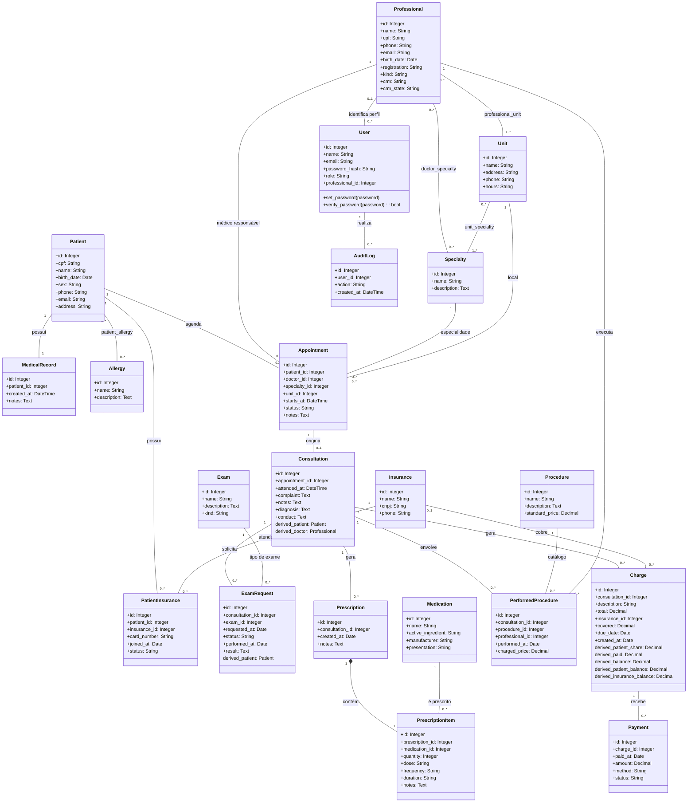

# Diagrama de classes

Os atributos são gerados diretamente de models.py. Os nomes em inglês correspondem ao código. As relações abaixo mostram multiplicidades do domínio; regras como pelo menos uma especialidade para médico são validadas também em services.py.

O modelo usa Professional com atributo kind em vez de uma hierarquia de subclasses. A categoria Médico exige CRM/UF e especialidades. O paciente e o médico de uma consulta são derivados do agendamento; o paciente do exame é derivado da consulta.

As quatro tabelas associativas sem atributos adicionais são doctor_specialty, professional_unit, unit_specialty e patient_allergy. PatientInsurance, PrescriptionItem e PerformedProcedure são classes associativas com dados próprios.

## Visão completa

## Regras de multiplicidade

- Patient–MedicalRecord é 1:1 no domínio. O serviço cria o prontuário automaticamente; a unicidade e a chave estrangeira impedem prontuário duplicado ou órfão. Um INSERT direto de Patient fora do serviço não cria automaticamente um MedicalRecord.
- Professional–Specialty é muitos para muitos. Para a categoria Médico, o serviço exige 1..* especialidades; outras categorias usam 0.
- Patient–PatientInsurance–Insurance guarda dados do vínculo e evita repetir o mesmo par paciente/operadora.
- Appointment–Consultation é 1 para 0..1. Cada consulta exige um agendamento único.
- Prescription–PrescriptionItem é composição, com pelo menos um item validado pelo serviço.
- Consultation–Charge e Charge–Payment permitem vários registros, preservando pagamentos parciais.

## Fontes e diagramas renderizados

- classes.puml: diagrama UML editável completo.
- classes.svg: versão vetorial, quando renderizada.
- casos-de-uso.puml e casos-de-uso.svg: atores e funcionalidades.

Para regenerar os atributos e fontes UML/DOT: `python scripts/generate_diagrams.py`. Os SVGs são renderizados localmente com Graphviz (Viz.js), com a mesma estrutura de classes e associações.